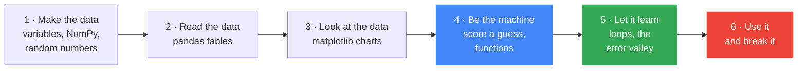

[← Back to AI/ML Track home](../../README.md)

# Week 1: Welcome and Python for data

**When:** Phase 1, week 1. Time and venue are posted in the track channel.

**Field:** 📊 Data

**Goal:** Make, read and plot data with Python, then build a tiny model by hand to see what machine learning is.

**Today's question:** *You run the campus tea stand. Can 120 days of notes tell you how much tea to make tomorrow?*

## 💡 Why this matters

Machine learning finds patterns in examples, so **a model is only as good as its data**. If a group of people, a season or a situation is missing from the data, it is missing from the model, and the model will not warn you. Today you build a dataset, read it, plot it, and train a model on it, so "training a model" becomes something you have done rather than a phrase.

## Learning objectives

By the end you should be able to:

- Explain machine learning in one sentence (*learn the rule from examples instead of writing it by hand*), and tell AI, ML, deep learning and generative AI apart
- Run a notebook in Colab and save your own copy
- Use variables, NumPy arrays and random numbers to build a small dataset
- Read a table with pandas (columns, summaries, sorting, filtering, groups) and plot it with matplotlib
- Explain **model**, **parameters**, **loss** and **training** using a straight line as the example
- Describe how the track works and how to contribute

## Before the session

- [ ] Finish the [Getting Started](../../GETTING-STARTED.md) checklist (GitHub with 2FA, Google account)
- [ ] Read [the vision](../../vision/README.md): what people are already doing with this field
- [ ] Skim [Stage 1: Foundations](../../learning-path/01-foundations.md)
- [ ] New to Python? Do the first two [Kaggle Learn Python](https://www.kaggle.com/learn/python) lessons, and tell the Track Lead so we can pair you up

## Agenda

1. Arrive and set up: open Colab, fix login problems (10 min)
2. Welcome and a tour of the track and how we work (10 min)
3. **The tea puzzle**: rules versus learning, then live-code Part 1.1 on the projector (15 min)
4. Notebook in pairs: Parts 1 to 5 (40 min)
5. 🛡️ Responsible AI moment: Part 6, the storm day (5 min)
6. Share-out: best hand-tuned score versus the machine, then the take-home challenge (10 min)

## How this session teaches

Each part teaches **one thing**, and the next part uses it:



In Part 1 **you write the secret recipe** (*180 cups, plus 3 per mm of rain, ...*) and use it to generate 120 days of notes. Then the recipe is hidden: in Part 4 you try to recover it by hand, and in Part 5 the computer recovers it on its own. Because you wrote the answer, you can check whether the machine really learned it.

## Hands-on reference

[](https://colab.research.google.com/github/GDG-TUM/AI-ML-Track-GDG-on-Campus-TUM/blob/main/weekly-sessions/week-01-welcome-and-python-for-data/python_for_data.ipynb)

Notebook: [`python_for_data.ipynb`](python_for_data.ipynb).

| Part | You learn | The next part uses it to... |
|:-:|---|---|
| 1 | **Make the data:** the recipe for one day, then 5 days with NumPy, then 120 days with noise | ...have notes to study |
| 2 | **Read the data:** a pandas table, one column, `describe`, sort, filter, `groupby` | ...pick out what to plot |
| 3 | **Look at the data:** a bar chart, a scatter plot, correlation | ...see the pattern to learn |
| 4 | **Be the machine:** score one guess, wrap it in a function, tune a line by hand | ...try many guesses quickly |
| 5 | **Let the machine learn:** a loop over guesses, the error valley, `np.polyfit` | ...get the best model |
| 6 | **Use the model:** tomorrow's forecast, the vocabulary, and when not to trust it | |

## 🛡️ Responsible AI moment

The notes never exceed about 24 mm of rain. Ask: **what will the model say for a 150 mm storm that closes the campus?** Run the cell together: it says about 700 cups, with no warning.

Then ask: **who is missing from the notes?** (Students who never buy tea, closed days, weekends.) Whatever is missing from the data is missing from the model.

## 🏁 Take-home challenge

- [ ] Finish the notebook challenges (the first three are required)
- [ ] Pick a small [Kaggle](https://www.kaggle.com/datasets) dataset you care about and make **one chart** and **one surprising finding**
- [ ] **Add your profile** to the repo: your first pull request ([members/](../../members/README.md))
- [ ] Open a **Member Roadmap** issue in [member-roadmaps](https://github.com/GDG-TUM/member-roadmaps)

Post your chart or questions in the track channel, or open an issue.

<details>
<summary><b>🎤 Host guide: how to run the 15-minute tea puzzle</b></summary>

<br/>

**Beat 1: the hook (2 min).** Project: *"You run the campus tea stand. How many cups do you make tomorrow?"* Take two or three answers, then ask what they would want to know first. Expect "the weather" and maybe "exams".

**Beat 2: rules versus learning (3 min).** Write these on the board:

```text
Traditional programming:   data + rules     ──►  answers
Machine learning:          data + answers   ──►  rules
```

Ask for a rule ("if it rains, make 220"), then ask how they would choose 220. From *past days*: that is learning.

**Beat 3: write the recipe (5 min).** Live-code Part 1.1, typing slowly, and work out 202 cups on the board so everyone sees the code does the same sum. Ask the *Predict first* question (no rain, exam week). Then: *"You just wrote the secret recipe. Soon we hide it and see whether the computer can find it."*

**Beat 4: show the goal (1 min).** Scroll to the Part 4 chart with the red sticks: *"In 30 minutes you will fit this line by hand, then the computer will do it for you."*

**Beat 5: hand over (1 min).** Pairs start at Part 1.2; driver and navigator swap at Parts 3 and 5. Start a best-score leaderboard for Part 4. The best possible line scores about 16.4, so under 18 is very good.

**Snags to expect**

| Snag | What to do |
|---|---|
| The slider cell errors | It is optional: skip it and re-run `try_line(...)` with new numbers |
| "NameError: name 'df' is not defined" | A cell was skipped: **Runtime → Run before** |
| Pairs are running out of time | At minute 30, live-code Part 5 on the projector |
| Someone finishes early | Point them to challenge 4: "who does the line get wrong?" |
| "Why doesn't `polyfit` match my best score?" | It squares the misses, so it scores lines slightly differently (week 2) |

</details>

## 📝 Session notes

Add slides, links, recordings and key takeaways here after the session (via pull request).

- Slides: *to be added*
- Recording: *to be added*
- Extra resources: [Sebastian Lague: How to Create a Neural Network](https://www.youtube.com/watch?v=hfMk-kjRv4c), the same knobs-by-hand idea and a good preview of week 4

---
[All sessions](../README.md) | [Week 2 →](../week-02-your-first-model/README.md)
