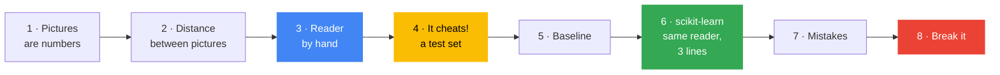

[← Back to AI/ML Track home](../../README.md)

# Week 2: Your first model

**When:** Phase 1, week 2. Time and venue are posted in the track channel.

**Field:** 🧮 Classical ML

**Goal:** Build a handwriting reader by hand, test it fairly, then rebuild it in three lines of scikit-learn.

**Today's question:** *The campus office types in handwritten student numbers by hand. Can a computer read the digits instead?*

## 💡 Why this matters

"My model is 99% accurate" means nothing until you know **what it was tested on** and **what guessing would score**. Today your own reader scores 100% by quietly cheating, and you fix it with a test set and a baseline. Those two habits turn a number into evidence. You also learn `fit`, `predict` and `score`, the three verbs used by almost every model you will meet.

## Learning objectives

By the end you should be able to:

- Explain the difference between **regression** (predict a number) and **classification** (predict a category)
- Explain how a picture becomes a row of features
- Build a nearest-neighbour classifier by hand, and explain how it decides
- Explain why we keep a **test set**, and compare a score with a **baseline**
- Use scikit-learn's `fit`, `predict` and `score`
- Read a confusion matrix, spot **overfitting**, and look at a model's real mistakes

## Before the session

- [ ] Finish [Week 1](../week-01-welcome-and-python-for-data/README.md) and its notebook
- [ ] Read the first half of [Stage 2: Core ML](../../learning-path/02-core-ml.md)
- [ ] Make sure you can open a notebook in Colab and save a copy

## Agenda

1. Arrive and set up (10 min)
2. Recap of Week 1: model, parameters, loss, training (5 min)
3. **The digit puzzle**: pictures are numbers, and how *you* would read a digit (20 min)
4. Notebook in pairs: run Parts 1 to 3 quickly, then work through Parts 4 to 7 (40 min)
5. 🛡️ Responsible AI moment: Part 8, the shifted digits (5 min)
6. Share-out and take-home challenge (10 min)

## How this session teaches

Each part uses the one before it, and Week 1's skills:



Students build the **nearest-neighbour** reader themselves: measure how different two pictures are, then copy the label of the most similar one. It scores 100%, because every picture finds *itself*. That failure motivates the test set. Then scikit-learn's `KNeighborsClassifier` makes **exactly the same guesses** as their hand-built version, which shows the library is not magic.

## Hands-on reference

[](https://colab.research.google.com/github/GDG-TUM/AI-ML-Track-GDG-on-Campus-TUM/blob/main/weekly-sessions/week-02-your-first-model/first_model.ipynb)

Notebook: [`first_model.ipynb`](first_model.ipynb). The dataset ships with scikit-learn, so nothing needs downloading.

| Part | You learn | Built on |
|:-:|---|---|
| 1 | **Pictures are numbers:** an 8 × 8 image as an array, then as a row of 64 features | Week 1: arrays, tables |
| 2 | **Distance:** how different two pictures are | Week 1: the average miss |
| 3 | **A reader by hand:** copy the label of the nearest picture. It scores 100%... | Week 1: functions, loops, `argmin` |
| 4 | **A fair exam:** the training set and the test set | Part 3's cheating |
| 5 | **A baseline:** what guessing would score | Part 4's score |
| 6 | **scikit-learn:** the same reader in three lines; a decision tree that overfits | Parts 3 to 5 |
| 7 | **Mistakes:** the confusion matrix, and the real errors | Part 6 |
| 8 | **When not to trust it:** digits shifted one pixel | Part 6 |

The three verbs you will use for almost every model in this track:

```python
model.fit(X_train, y_train)          # learn from examples
model.predict(X_test)                # guess on new data
model.score(X_test, y_test)          # how good were the guesses?
```

## 🛡️ Responsible AI moment

Run Part 8 together. Shifting every test digit **one pixel to the right**, a change no person would struggle with, drops the reader from about 99% to 58%. Two pixels drops it to 13%. Then ask: **whose handwriting is in the training data, and whose is not?** Imagine this reader processing forms at a campus office.

## 🏁 Take-home challenge

- [ ] **Ask more neighbours:** plot training and test accuracy for 1, 3, 5, 15 and 50 neighbours
- [ ] **Fix the shift** with data augmentation: add shifted copies to the training set and re-test
- [ ] Optional: try `RandomForestClassifier`. Does it overfit less than one tree?
- [ ] Write **five sentences**: which model would you use for campus forms, and what would worry you before using it?

Post your chart and your five sentences in the track channel.

<details>
<summary><b>🎤 Host guide: how to run the 20-minute digit puzzle</b></summary>

<br/>

**Beat 1: recap (2 min).** Ask: *"Last week, what were the model, the parameters and the loss?"* (A line, two knobs, the average miss.) Then: *"Last week we predicted a number. Today we predict a category."*

**Beat 2: pictures are numbers (5 min).** Run Part 1.1 and print `images[0]`. Ask the room to find the 0 in the numbers before you show the picture.

**Beat 3: how would *you* read a digit? (5 min).** Ask for ideas. Steer towards *"compare it with examples I've seen."* Run Part 2: the two zeros are about 3× closer than a zero and a one. Show the red difference picture.

**Beat 4: the cheat (5 min).** Live-code Part 3's `read_digit` and run it on all pictures. Before you run it, ask for predicted accuracy. It prints **100%**. Ask: *"Is it perfect?"* Let someone work out that every picture found itself. That is your bridge to the test set.

**Beat 5: hand over (3 min).** Pairs run Parts 1 to 3 to catch up, then continue from Part 4. Driver and navigator swap at Part 6.

**Snags to expect**

| Snag | What to do |
|---|---|
| "What's `axis=1`?" | "Add along each row." Point at the table in Part 1.2: one row per picture |
| Part 3 feels slow | It compares every picture with every other one (about 3 million comparisons). A second or two is normal |
| "Why is 98.7% different from the decision tree's score?" | Different models learn different rules. The tree also overfits, which is week 3's topic |
| Someone finishes early | Challenge 2, data augmentation. It fixes Part 8 |

</details>

## 📝 Session notes

Add slides, links, recordings and key takeaways here after the session (via pull request).

- Slides: *to be added*
- Recording: *to be added*
- Extra resources: *to be added*

---
[← Week 1](../week-01-welcome-and-python-for-data/README.md) | [All sessions](../README.md) | [Week 3 →](../week-03-evaluate-honestly/README.md)
