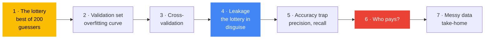

[← Back to AI/ML Track home](../../README.md)

# Week 3: Evaluate honestly

**When:** Phase 1, week 3. Time and venue are posted in the track channel.

**Field:** 🧮 Classical ML

**Goal:** Learn to tell when a score deserves to be believed.

**Today's question:** *A random guesser just scored 80%. How?*

## 💡 Why this matters

This is the most important week of Phase 1. Most real-world ML failures are not bad models but **bad evaluations**: the model was never as good as the team believed. Today you watch coin-flip guessers score 80% and a careful-looking workflow "discover" a pattern in pure noise. If it can fool you on coin flips, it can fool you on data about real people. Catching these traps is what separates someone who can *run* ML from someone who can be *trusted* with it, and AI coding assistants fall into them too.

## Learning objectives

By the end you should be able to:

- Explain why choosing models with the test set is cheating, and use a **validation set** instead
- Recognise **underfitting** and **overfitting** on a training-versus-validation chart
- Use **cross-validation**, and read both the average and the spread
- Explain **data leakage** and prevent it with a `Pipeline`
- Explain why **accuracy can mislead**, and work out **precision** and **recall** from a confusion matrix
- Fill gaps and turn text into numbers, ready for a first Kaggle submission

## Before the session

- [ ] Finish the [Week 2](../week-02-your-first-model/README.md) notebook
- [ ] Create a free [Kaggle](https://www.kaggle.com) account and verify your phone number if Kaggle asks (needed for some features)
- [ ] Read the rest of [Stage 2: Core ML](../../learning-path/02-core-ml.md)

## Agenda

1. Arrive and set up (10 min)
2. Recap of Week 2: the test set, the baseline, overfitting (5 min)
3. **The lottery**: run Part 1 live, then explain the three piles (15 min)
4. Notebook in pairs: Parts 2 to 5 (45 min)
5. 🛡️ Responsible AI moment: Part 6, who pays for each mistake? (5 min)
6. Share-out, the checklist, and the take-home challenge (10 min)

## How this session teaches

Each trap is a new disguise for the same mistake: **letting the exam leak into the studying**.

Part 1 shows the core idea with nothing but coin flips: try 200 random guessers on one test set, keep the best, and it scores 80%. Part 4 is the same lottery hidden inside a preparation step. Part 5 reuses Week 2's nearest-neighbour voting as a knob that trades catching more faulty items against raising more false alarms.

## Hands-on reference

Notebook: [`evaluate_honestly.ipynb`](evaluate_honestly.ipynb).

| Part | You learn | Built on |
|:-:|---|---|
| 1 | **The lottery:** the best of 200 random guessers scores about 80% | Week 2: the test set |
| 2 | **Three piles:** training, validation, test; the overfitting curve | Part 1, Week 2's decision tree |
| 3 | **Cross-validation:** every example gets a turn in validation | Part 2 |
| 4 | **Leakage:** pure noise "scores" over 80% until a `Pipeline` brings it back to about 50% | Parts 1 and 3 |
| 5 | **The accuracy trap:** "always fine" is 95% accurate and catches nothing; precision and recall | Week 2: confusion matrix, voting |
| 6 | **Who pays for each mistake?** | Part 5 |
| 7 | **Real data is messy:** fill gaps, turn text into numbers (take-home warm-up) | Week 1: pandas; Part 4 |

**The honest evaluation checklist:**

- [ ] A baseline to beat
- [ ] Settings chosen on validation data, never on the test set
- [ ] Every step that learns from data inside a `Pipeline`
- [ ] More than accuracy
- [ ] Real mistakes inspected by eye
- [ ] Who is hurt when the model is wrong

## 🛡️ Responsible AI moment

Part 5 ends with a knob: flag more items and you catch more real cases, but raise more false alarms. Ask the room where they would set it for a factory, a medical screening test, a fraud filter that freezes students' bank accounts, and an exam-proctoring tool. **Who pays for the false alarms, and who pays for the misses?** The right metric depends on the answer, and that answer is a human one, not a mathematical one.

## 🏁 Take-home challenge

- [ ] Make your **first Kaggle submission** on the [Titanic competition](https://www.kaggle.com/competitions/titanic), with the gap-filling and text steps inside a `Pipeline` (Part 7). Report your cross-validation score *and* your leaderboard score. Are they close? If not, why?
- [ ] In the leakage demo, change `k=20` to `k=5` and `k=200`. What happens to each score?
- [ ] Plot recall and precision against the number of votes needed
- [ ] Write three sentences about a real-life model where accuracy alone would mislead

<b>🎤 Host guide: how to run the 15-minute lottery</b>

 

**Beat 1: the bet (3 min).** Say: *"I have an exam of 40 coin flips. Nothing can be learned. I'm going to enter 200 models that guess at random."* Ask the room what the best one will score. Most will say a bit over 50%.

**Beat 2: the reveal (2 min).** Run Part 1.1: the best scores about 80%. Then run 1.2: on a new exam it drops to about 50%. Ask: *"Was it a good model?"*

**Beat 3: where this happens for real (5 min).** Point out that trying many models or settings and keeping the best *test* score is the same lottery. Recall Week 2's challenge, choosing neighbours by test score. Draw the three piles on the board: homework (training), practice exams (validation), the real exam (test, used once).

**Beat 4: hand over (5 min).** Show the overfitting chart from Part 2 so pairs know what they are aiming for, then pairs start at Part 2. Driver and navigator swap at Part 4.

**Snags to expect**

| Snag | What to do |
|---|---|
| "Isn't the validation set also used to choose? Can't it leak too?" | Yes, a little, which is why the test set exists and is touched once. Great question |
| `predict_proba` in Part 5 | "The fraction of the 5 neighbours that voted faulty." Multiplying by 5 gives the vote count |
| `&` and `~` in Part 5 | "and" and "not", applied to every item at once, like Week 1's comparisons |
| Short of time | Do Part 3 (cross-validation) on the projector and let pairs skip to Part 4 |

## 📝 Session notes

Add slides, links, recordings and key takeaways here after the session (via pull request).

- Slides: *to be added*
- Recording: *to be added*
- Extra resources: *to be added*

---
[← Week 2](../week-02-your-first-model/README.md) | [All sessions](../README.md) | [Week 4 →](../week-04-neural-networks-from-scratch/README.md)
