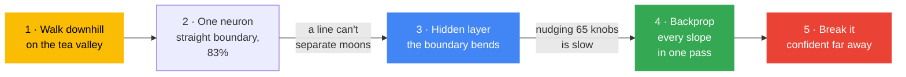

[← Back to AI/ML Track home](../../README.md)

# Week 4: Neural networks from scratch

**When:** Phase 1, week 4. Time and venue are posted in the track channel.

**Field:** 🧠 Neural networks

**Goal:** Remove the magic from deep learning by training a neural network with nothing but NumPy, then start your mini-project.

**Today's question:** *Week 1 found the best tea line by trying 200 values. A chatbot has billions of knobs. How does it find the bottom of the valley?*

## 💡 Why this matters

Every modern neural network learns with the same loop: **measure how wrong you are, work out which way to nudge each knob, nudge, repeat.** That includes the large language models behind Gemini and ChatGPT. They have billions of knobs instead of 65, but the idea is identical. Once you have written the loop yourself, "training", "parameters" and "learning rate" become things you understand, and when a real training run fails you will know where to look.

## Learning objectives

By the end you should be able to:

- Explain **gradient descent** as "feel the slope, step downhill, repeat", and what the **learning rate** does
- Explain what a neuron computes, and why one neuron can only draw a straight boundary
- Explain why a **hidden layer** with an **activation function** lets a network draw curves
- Describe **backpropagation** as "blame flowing backwards" (the chain rule), and verify it with a **gradient check**
- Explain why a model's confidence is not the same as knowledge
- Choose a partner and a dataset for your Phase 1 mini-project

## Before the session

- [ ] Finish [Week 3](../week-03-evaluate-honestly/README.md)
- [ ] Optional but great: watch [Sebastian Lague: How to Create a Neural Network](https://www.youtube.com/watch?v=hfMk-kjRv4c) or the first video of [3Blue1Brown's neural network series](https://www.3blue1brown.com/topics/neural-networks)
- [ ] Think of **one small dataset** you would like to use for your mini-project (or plan to reuse your Week 3 Titanic model)

## Agenda

1. Arrive and set up (10 min)
2. Recap: Week 1's error valley (5 min)
3. **Walk downhill**: run Part 1 live, from one slope to gradient descent (15 min)
4. Notebook in pairs: Parts 2 to 4, from one neuron to backpropagation (35 min)
5. **Mini-project kickoff:** pick a partner and a dataset (15 min)
6. 🛡️ Responsible AI moment: Part 5, confident far from the data (5 min)
7. Wrap-up and take-home challenge (5 min)

## How this session teaches

Each step is forced by a limit of the one before:

Part 1 rebuilds Week 1's tea line with **gradient descent**: nudge a knob, feel the slope, step against it. It lands on exactly `np.polyfit`'s answer. The same two functions, `nudge_slopes` and `descend`, then train one neuron (Part 2) and a 65-knob network (Part 3) unchanged. Nudging is slow, which motivates **backpropagation** (Part 4). The slow nudging method then becomes the gradient check that proves backprop is right.

## Hands-on reference

Notebook: [`neural_net_from_scratch.ipynb`](neural_net_from_scratch.ipynb).

| Part | You learn | Built on |
|:-:|---|---|
| 1 | **Walk downhill:** slopes by nudging, gradient descent, the learning rate | Week 1: the tea line and error valley |
| 2 | **One neuron:** weighted sum, sigmoid, cross-entropy; a straight boundary at 83% | Part 1's `descend` |
| 3 | **A hidden layer:** 16 neurons, tanh, 65 knobs; the boundary bends | Part 2's neuron |
| 4 | **Backpropagation:** all 65 slopes in one pass, checked against nudging; snapshots of learning | Parts 1 and 3 |
| 5 | **When not to trust it:** about 100% sure in places it has never seen | Week 1's storm day |

### The Phase 1 mini-project

In pairs, you will run the whole Phase 1 workflow on one small dataset and present it in [Week 6](../week-06-phase-1-showcase/README.md). About **3 hours of work in total**. Good choices:

- Your **Titanic** model from Week 3, improved and honestly evaluated
- The **photo classifier** you will build next week
- A small [Kaggle dataset](https://www.kaggle.com/datasets) (under about 10,000 rows) about something you care about

The five things your project must show are listed on the [Week 6 page](../week-06-phase-1-showcase/README.md#the-mini-project). Need inspiration? See the [project ideas](../../projects/ideas.md) (the beginner ones fit).

## 🛡️ Responsible AI moment

Run Part 5 together: zoomed out, the network gives about 0% or 100% to points far from every training example. **A model's confidence is not knowledge.** Then turn to the mini-projects: **who or what is in your dataset, and who is missing?** If it is about people, would they be happy to know how it is used?

## 🏁 Take-home challenge

- [ ] Try the experiments at the bottom of the notebook (network size, learning rate, ReLU with a gradient check, overfitting). **Predict first, then run.**
- [ ] Post your mini-project pair and dataset in the track channel
- [ ] Mini-project steps 1 and 2: explore the data (one chart) and get a **baseline** score

<b>🎤 Host guide: how to run the 15-minute walk downhill</b>

 

**Beat 1: the recap (2 min).** Show Week 1's error valley. Ask: *"How did the computer find the bottom?"* (It tried 200 values.) *"What if there were a billion knobs?"*

**Beat 2: feel the slope (5 min).** Use the "standing on a hill in the dark" picture. Run Part 1.3. Before you run it, ask whether the slope at `per_mm = 0` is positive or negative. Then run 1.4 and watch the dots roll down.

**Beat 3: the learning rate (3 min).** Ask what a 5× smaller and a 2× bigger step will do, then run the three-panel chart. The bouncing one always gets a reaction.

**Beat 4: every knob (3 min).** Run 1.5: gradient descent lands on exactly `np.polyfit`'s answer. Say: *"Keep these two functions in mind. They will train a neural network in 20 minutes."*

**Beat 5: hand over (2 min).** Pairs start at Part 2. Driver and navigator swap at Part 4. Leave 15 minutes at the end for the mini-project kickoff, whatever happens.

**Snags to expect**

| Snag | What to do |
|---|---|
| Part 3.2 takes about 10 seconds | That is the point: nudging is slow. Ask them to time it, then compare with Part 4.3 |
| "What does `@` do?" | Every hidden neuron's weighted sum at once: each column of `W1` is one neuron's two weights |
| Backprop maths feels heavy | The gradient check is what matters: two different methods, the same slopes. The exact formulas are optional |
| Running out of time | Show Part 4 on the projector; never cut the mini-project kickoff |

## 📝 Session notes

Add slides, links, recordings and key takeaways here after the session (via pull request).

- Slides: *to be added*
- Recording: *to be added*
- Extra resources: [Sebastian Lague: How to Create a Neural Network](https://www.youtube.com/watch?v=hfMk-kjRv4c), [3Blue1Brown: Neural networks](https://www.3blue1brown.com/topics/neural-networks)

---
[← Week 3](../week-03-evaluate-honestly/README.md) | [All sessions](../README.md) | [Week 5 →](../week-05-deep-learning-in-practice/README.md)
