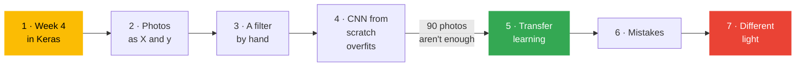

[← Back to AI/ML Track home](../../README.md)

# Week 5: Deep learning in practice

**When:** Phase 1, week 5. Time and venue are posted in the track channel.

**Field:** 🧠 Neural networks

**Goal:** Rebuild Week 4's network in Keras, then train a photo classifier on a free GPU by borrowing a pretrained model.

**Today's question:** *Week 2's reader needed 1,347 tidy digits. Can 90 phone photos teach a computer to see?*

## 💡 Why this matters

Training a big model from scratch needs millions of examples and serious compute, so almost nobody does it. Real projects **start from a model that has already learned** and adapt it, so a few dozen of your own photos are enough. This is how most modern AI is built, including the large language models in Phase 2. It also brings back an old lesson in a new form: a model that works on *your* photos may quietly fail on someone else's.

## Learning objectives

By the end you should be able to:

- Map Keras's `Dense`, `compile` and `fit` onto the network you built by hand in Week 4
- Explain what a **convolution** looks for in an image, and why CNNs suit photos
- Show why a CNN trained from scratch on 90 photos **overfits**
- Explain **transfer learning**: freeze a pretrained model and train a new last layer
- Turn on a free GPU in Colab, and train within its limits
- Test a model on photos taken in different conditions, and explain what happens

## Before the session

- [ ] Finish [Week 4](../week-04-neural-networks-from-scratch/README.md)
- [ ] Skim [Stage 3: Deep learning](../../learning-path/03-deep-learning.md)
- [ ] Take **30 photos each of 3 kinds of objects** with your phone (for example, three kinds of fruit, shoes or tools). **Objects, not people.** Put them in a folder called `my_photos` with one sub-folder per kind, and zip it. On an iPhone, set *Camera → Formats → Most Compatible* first, so the photos are JPG.
- [ ] No photos? That is fine: the notebook falls back to a sample of flower photos

## Agenda

1. Arrive and set up: GPU runtime on, `my_photos.zip` uploaded (10 min)
2. Recap: Week 4's network, now in Keras. Run Part 1 live (10 min)
3. Concept: what a convolution sees. Run Part 3 live (10 min)
4. Notebook in pairs: Parts 2, 4, 5 and 6 on your own photos (45 min)
5. 🛡️ Responsible AI moment: Part 7, the same photos in different light (5 min)
6. Share-out, mini-project check-in, take-home challenge (10 min)

## How this session teaches

Part 1 rebuilds Week 4's 65-knob moons network in a few lines of Keras and gets the same accuracy, so `fit` stops being magic. Photos then load as plain `X` and `y` arrays and split with `train_test_split`, exactly as in Weeks 2 and 3. A CNN trained from scratch reaches about 100% on training but only about 60% on validation. Borrowing MobileNetV3's eyes and training only its last layer (about 1,700 knobs) reaches about 90%.

## Hands-on reference

Notebook: [`photo_classifier.ipynb`](photo_classifier.ipynb). It uses **Keras 3**, which is preinstalled in Colab.

> [!NOTE]
> This is the one notebook that CI does not run, because it needs a deep-learning framework, downloads and your photos. See [decision 0007](../../docs/decisions/0007-week-5-lab-not-run-in-ci.md). **Dry-run it on a fresh Colab before every session.**

| Part | You learn | Built on |
|:-:|---|---|
| 1 | **Week 4 in Keras:** `Dense`, `compile`, `fit`; mini-batches and epochs | Week 4 |
| 2 | **Your photos as numbers:** upload, `X` and `y`, two piles | Weeks 2 and 3 |
| 3 | **What a convolution sees:** edge filters slid across a photo by hand | Week 2: pictures are numbers |
| 4 | **A CNN from scratch:** learned filters, pooling, softmax; it overfits | Week 3: training vs validation |
| 5 | **Transfer learning:** freeze MobileNetV3, train a new last layer | Part 4's problem |
| 6 | **Mistakes:** confusion matrix and the wrong photos | Week 2 |
| 7 | **When not to trust it:** dim, warm and black-and-white versions | Weeks 1, 2 and 4 |

> [!TIP]
> Keep images small and the model small. A free GPU is generous but not unlimited, and **a session that is allowed to finish beats a clever one that times out**. See the [compute guide](../../resources/compute-guide.md). This notebook also runs on a CPU, only slower.

## 🛡️ Responsible AI moment

Run Part 7 together. The same validation photos are shown dimmed, under a warm lamp, and in black and white. A person can still name every object, but the model's accuracy drops, often most in black and white. **If a model works on your phone's photos, whose photos might it fail on?** Also discuss why we photograph **objects, not people**: faces are personal data, and pretrained models can carry biases from the photos they learned from.

## 🏁 Take-home challenge

- [ ] **The real test:** take 5 new photos of each object in different light or places, and score the model on them
- [ ] Try **one improvement** (more photos, augmentation, fine-tuning) and report whether it helped
- [ ] **Finish your mini-project** with your partner: a model that beats your baseline, an honest evaluation and one risk. Then prepare your 3-minute presentation for [Week 6](../week-06-phase-1-showcase/README.md).

<b>🎤 Host guide: running a GPU lab</b>

 

**Two days before.** Dry-run the notebook on a fresh Colab with a GPU, once with your own `my_photos.zip` and once without (the flower sample). Post a reminder about the photos and the iPhone format setting.

**Setup (10 min).** Helpers check that everyone has a GPU runtime and has uploaded the zip. If Colab has no free GPU, carry on with the CPU: everything runs, only slower.

**Part 1 live (10 min).** Put Week 4's NumPy notebook next to Part 1 and match each line to its Keras version, using the table in the notebook. The point to make: *"`fit` is the loop you wrote last week."*

**Part 3 live (10 min).** Before you run the edge filters, ask what a "vertical-edge detector" should light up on the photo. Then: *"A CNN learns thousands of these filters by itself."*

**Snags to expect**

| Snag | What to do |
|---|---|
| No GPU available | Use the CPU runtime; Part 4 and Part 5 take a few minutes each |
| `my_photos` not found | The zip must contain the `my_photos` folder at its top level. Otherwise the sample is used, which is fine |
| A photo fails to open | Probably HEIC from an iPhone, or a non-image file. Delete or convert it |
| Very different numbers from a neighbour | Expected with different photos, and even between GPU and CPU. Compare the *shape* of the curves |
| Running out of time | Skip Part 4's training: show its chart on the projector, then go straight to Part 5 |

## 📝 Session notes

Add slides, links, recordings and key takeaways here after the session (via pull request).

- Slides: *to be added*
- Recording: *to be added*
- Extra resources: [Keras transfer learning and fine-tuning guide](https://keras.io/guides/transfer_learning/)

---
[← Week 4](../week-04-neural-networks-from-scratch/README.md) | [All sessions](../README.md) | [Week 6 →](../week-06-phase-1-showcase/README.md)
